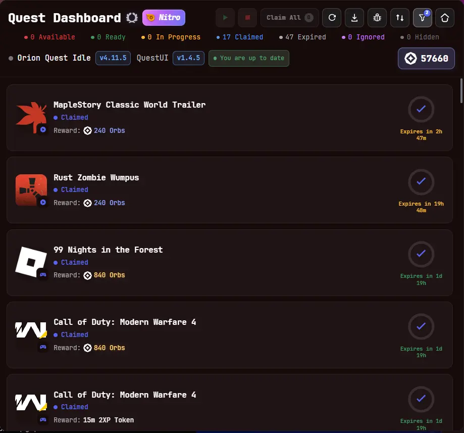

# QuestUI

QuestUI is a standalone Vencord userplugin for quick access to Discord Quests and a compact, live view of their state.

QuestUI is UI-focused rather than a Quest-completion engine. It performs only explicit user-authorized native Quest actions: **Accept Quest**, per-card **Claim Reward**, and bounded sequential **Claim all** for a fixed snapshot of Ready rewards. It does not generate Quest progress, spoof games/streams, claim rewards in the background without user authorization, or bypass Discord challenges.

## Screenshots

<p align="center">

  

</p>

The capture above is a real Discord runtime screenshot supplied by the maintainer and reflects the current Stable QuestUI interface.

## Features

- Optional Quest shortcut in Discord's top bar

- Optional Quest shortcut next to mute, deafen, and settings

- **Dashboard Mode** with a wider live Quest dashboard, enabled by default

- Eight always-visible summary totals: All, Available, Ready, In Progress, Claimed, Expired, Ignored, and Hidden

- Account-scoped **Ignore / Unignore** with a dedicated Ignored catalogue

- Configurable Vencord notifications for **New Quest Available**, **Ready to Claim**, and actionable runtime problems; all three categories are enabled by default

- Account-scoped **Notification Center** backed by Event Log events, with per-account unread/read/clear presentation state and Quest artwork for supported user-facing events

- Persistent Dashboard sorting, expired-history age filtering, and a compact Home action

- Native current Orb balance plus Orion Quest / QuestUI runtime version metadata

- Persistent **Event Log** with account-aware searchable/filterable diagnostics, per-event details, sanitized one-click bug reports, complete pagination, and large-log windowed rendering

- Dashboard/Settings **Update Center** with per-product release-check health and last-success timestamps plus independent QuestUI/OrionQuests pre-release opt-ins. QuestUI self-update requires a clean official-history checkout and a pinned-key signed annotated release target on official `main`; it never discards dirty QuestUI work. OrionQuests source update is a separate QuestUI-owned path for the official upstream `main` checkout; dirty or locally divergent Orion work presents **Keep** or **Discard & update**, and destructive consent is rebound to the exact revalidated checkout snapshot before reset/clean. Vencord rebuilds after managed updates and restores the known-good runtime snapshot on guarded target-build failure.

- Discord Quest artwork, task-type badges, reward display, native progress ring, and expiry display

- Dashboard theme selector beside the Orb balance with a persistent choice and complete managed stylesheet lifecycle (Default only for now)
- Native Quick Open for enrolled, in-progress desktop video and Discord Activity Quests (`WATCH_VIDEO`, `PLAY_ACTIVITY`, `ACHIEVEMENT_IN_ACTIVITY` only), independent of Orion; opens Discord's video modal or invokes its Activity launch hook without external links or implicit enrollment
- Explicit **Accept Quest**, **Claim Reward**, and bounded sequential **Claim all** actions, with a 1-3 second pause between consecutive native claims

- Account-scoped duplicate-submission guards, compact Dashboard notices for successful in-Dashboard actions, and Vencord-native toasts for failures or utility feedback

- Floating filters for status, reward category, Quest type, expired history, and the separate Ignored catalogue

- Optional numeric **Detailed Status** badge and basic attention dot

- Color-coded counters on Discord's own Quest Home links

- Native **Reload** that asks Discord to refetch the current Quest list without Ctrl+R, plus enabled-by-default background auto reload that works without opening the Dashboard

- Account-aware Orb rewards from Discord's own base/boosted fields plus Discord's native multiplier eligibility, with Nitro and Xbox+ source badges

- Optional Orion integration, enabled by default when a compatible OrionQuests plugin is installed:

  - Smart **Start / Pause / Resume** global control

  - Separate **Stop** engine control

  - Compact exact-ID per-Quest **Pause / Resume** control after enrollment

  - Engine-wide Start when Orion is stopped

  - Exact-ID Orion Pause before Ignore when that Quest is explicitly active

  - Structured Orion diagnostics when the companion exposes `subscribeEvents()`

  - Live scheduler metadata when the companion exposes `getSchedulerSnapshot()` and `subscribeSchedulerState()`

QuestUI does not turn Stop into Pause, does not reset Quest progress, and does not implement a targeted `startQuest`. Orion's own scheduler and concurrency limits decide which enrolled Quests run or wait.

## Installation

### QuestUI

Install the default `main` branch.

#### UserpluginInstaller

Use the repository URL:

```text
https://github.com/Herzchens/QuestUI
```

#### Manual Vencord source install

```bash
cd Vencord/src/userplugins
git clone --branch main https://github.com/Herzchens/QuestUI.git QuestUI
cd ../..
pnpm build
pnpm inject
```

#### Updating QuestUI

If QuestUI is already installed in a normal Vencord source checkout, you do not need to clone it again.

From the Vencord source root:

```bash
git -C src/userplugins/QuestUI pull --ff-only
pnpm build
pnpm inject
```

If the existing `src/userplugins/QuestUI` directory is not a Git checkout, check the installation before deleting or replacing it.

### QuestUI + OrionQuests

QuestUI and OrionQuests remain separate Vencord userplugins. For Orion controls, use upstream **OrionQuests v4.10.7 or newer**.

If you already have a normal Vencord source checkout, install both repositories as sibling userplugins:

```bash
cd Vencord/src/userplugins

git clone https://github.com/Herzchens/QuestUI.git QuestUI

git clone https://github.com/nyxxbit/discord-quest-completer.git OrionQuests

cd ../..
pnpm build
pnpm test:ts
pnpm inject
```

### With Orion's devbuild installer

For the first installation:

```powershell
git clone https://github.com/Herzchens/QuestUI.git "$env:LOCALAPPDATA\OrionVencord\src\userplugins\QuestUI"
```

Then run Orion's `UPDATE.cmd` from the devbuild installer folder you originally extracted. This rebuilds Vencord with QuestUI included.

#### Updating an existing QuestUI installation

You do not need to delete and clone QuestUI again when a new version is released. `git clone` is only required for the initial installation.

Newer Orion devbuild installer versions can update sibling Git userplugins automatically. If `UPDATE.cmd` prints:

```text
Updating other userplugins in this checkout...
```

just run `UPDATE.cmd` from the extracted devbuild installer folder. Orion updates the companion checkout before rebuilding Vencord while preserving its updater safety rules.

If your extracted Orion devbuild installer does not include that companion-update step, update QuestUI manually first:

```powershell
git -C "$env:LOCALAPPDATA\OrionVencord\src\userplugins\QuestUI" pull --ff-only
```

Then run Orion's `UPDATE.cmd` again from the extracted devbuild installer folder so Vencord is rebuilt with the updated QuestUI.

If the existing `QuestUI` directory is not a Git checkout, do not delete or replace it blindly. Check how it was installed first.

## Dashboard

The visible heading is **Quest Dashboard** followed by Discord's native Quest icon.

> [!NOTE]
> **Dashboard Mode** defaults to enabled for fresh settings. Vencord preserves stored settings, so users who previously toggled `Dashboard • Mode` off keep that stored `false` value after upgrading and may need to enable it manually. This is expected persisted-setting behavior, not a regression.

QuestUI mirrors Discord's native Quest Orb multiplier identity in the Dashboard header. Native `NITRO` eligibility keeps the existing colored **Nitro** badge and badge artwork. `XBOX_GAME_PASS` eligibility shows a green **Xbox+** badge with the Xbox brand mark. When an account has both eligible sources, Discord's own source classifier prioritizes Nitro, so QuestUI shows **Nitro** rather than two badges. Nitro tiers that are not multiplier-eligible keep the legacy Nitro identity badge, but they still receive the base Quest reward.

The title uses a seamless right-to-left color sweep. `prefers-reduced-motion` disables the motion and keeps the title readable.

The summary row always renders all eight counters, including zero values:

- **Neutral** - All
- **Red** - Available
- **Green** - Ready
- **Yellow** - In Progress
- **Blue / Blurple** - Claimed
- **Gray** - Expired
- **Magenta / Purple** - Ignored
- **Muted gray** - Hidden

The five Discord-status counts come from the full non-ignored live Quest snapshot. **Ignored** is a separate account-scoped local-presentation count. **Hidden** counts only non-ignored cards removed by normal Dashboard filters, including expired-age filtering, so Ignore never inflates Hidden.

### Filters and sorting

The Filter popout supports:

- Status: Available, Ready, In Progress, Claimed, Expired
- Ignored catalogue: show locally ignored Quests separately from normal status filtering
- Expired history (when Expired is enabled): stepped 7d, 15d, 30d, 90d, or All history
- Reward presets: All, Orbs, Collectible, In Game Reward, or Custom
- Custom reward types: Orbs, Avatar Decoration, Profile Effect, Nameplate, Profile Frame, Bundle, Other Collectible, Nitro Credits, Gift Code, In Game Item, and Unknown / Future
- Quest type: Play, Stream, Video, Activity, Other / Unknown

The Sort popout supports **Expiring Soon**, **Highest Orb Reward**, **Shortest Required Time**, **Longest Required Time**, **Name A → Z**, and **Name Z → A**. Expiring Soon is the default/fallback sort mode. Required-time sorting compares normalized timed-task seconds; achievement/count objectives are not misread as durations.

QuestUI and OrionQuests settings are available directly from their product status cards.

### Ignore / Unignore

Ignore is account-scoped and persisted locally by QuestUI. It does not change Discord enrollment, progress, completion, reward, or claim state.

A normal **In Progress** Quest can be ignored. Ignored Quests are removed from the normal Dashboard list and from QuestUI attention surfaces, including the shortcut attention dot, Detailed Status, Quest Home counters, and QuestUI notifications. They remain visible through the explicit **Ignored** catalogue with their real Discord status and progress until Discord reports them **Expired**. Expiration immediately ends Ignore, and QuestUI prunes the stale account-scoped ignored ID best-effort.

When a compatible Orion integration is enabled and Orion explicitly publishes that exact Quest as active (`RUNNING` / `QUEUE`, or scheduler `running` / `waiting`), QuestUI sends Orion an exact-ID **Pause** before it saves Ignore. This prevents a hidden Quest from continuing to farm in the background.

If Orion still reports the Quest as active after a failed Pause attempt, Ignore fails closed and the Quest stays visible. QuestUI never converts Ignore into a global Stop. If the Orion Pause succeeds but local Ignore persistence later fails, the Quest remains visible and paused rather than being auto-resumed as a rollback.

**Unignore never auto-resumes or starts Orion.** It only restores the Quest to normal QuestUI presentation so the user can explicitly decide whether to resume it.

### Live progress

QuestUI reads Discord's native Quest selectors and QuestStore rather than running a separate progress engine.

For timed tasks, the secondary progress copy uses fixed `mm:ss / mm:ss` formatting, for example:

```text
Play · 03:02 / 15:00
```

Only the **current elapsed value** (`03:02`) receives completion-stage color. The task label, separator, slash, and target remain neutral so progress color does not leak across the whole row.

The color progression is semantic progress, not urgency: muted at the beginning, then Discord brand tones, then positive green as completion approaches.

Dashboard expiry copy is shown whenever Discord provides a valid Quest expiry. The separate **Expired Age** filter offers 7d, 15d, 30d, 90d, and **All**; v1.6 defaults to **All** (`0`) so the complete expired history remains visible until the user narrows it.

### Runtime metadata and Orb balance

The metadata row shows Orion integration health/version, the current QuestUI version, and the current native Orb balance. Stable releases, prerelease/dev builds, and unknown version strings use different version-chip treatments so build channel and integration health are not conflated.

Orb balance comes from Discord's `VirtualCurrencyStore`; QuestUI does not derive the balance from Quest rewards, poll a custom endpoint, or optimistically increment it. A real zero balance remains visible as `0`.

### Rewards

Orb rewards reuse Discord's themed Orb component. QuestUI reads both Discord's base `orbQuantity` and explicit `premiumOrbQuantity`, then asks Discord's own Quest multiplier classifier whether the current account is `NITRO`, `XBOX_GAME_PASS`, `UPSELL`, or `INELIGIBLE`. It does **not** manufacture a local `×1.2` value.

If the native classifier says the account receives the multiplier, the card displays Discord's `premiumOrbQuantity` (for example `240 Orbs` instead of the `200 Orbs` base). Otherwise it displays the base amount. Xbox Game Pass is therefore identified from Discord's native classifier or, when that webpack surface is unavailable, directly from Discord's `MORE_QUEST_ORBS` perk source. It is never guessed from `!Nitro` or from the existence of a boosted reward field.

## Notifications

QuestUI has three separately configurable notification categories in the QuestUI plugin settings, and all three default to enabled:

- **Notifications • New Quest Available** - one notification when a previously unseen same-account Quest is first observed as real Discord **Available** after the initial QuestStore baseline.
- **Notifications • Ready to Claim** - one notification when an observed same-account Quest transitions from real Discord **In Progress** to **Ready to Claim**.
- **Notifications • Problems** - actionable QuestUI/Orion runtime problems from the sanitized Event Log. User-facing terminal outcomes notify; Orion's structured request-layer `network.failed` stays diagnostic so the owning terminal task/enroll/claim/bypass outcome produces the alert instead of a duplicate.

QuestUI uses Vencord's Notifications API instead of a companion bot, backend, DM relay, or parallel OS-notification system. Delivery therefore follows Vencord's notification configuration: Vencord in-app notification, native desktop notification when Discord is unfocused, or native desktop notification always. Vencord also persists normal notifications into its Notification Log according to the user's global log settings.

New-Quest notifications establish the initial QuestStore/account contents as a baseline, so startup, account hydration, and Ignore/Unignore do not create a synthetic "new Quest" alert. Ready-to-Claim notifications likewise do not replay existing completed Quests on startup, account switch, Ignore/Unignore hydration, or setting enablement. Progress ticks and unchanged re-renders do not notify. Clicking a QuestUI/Vencord notification opens the Quest Dashboard when a registered Dashboard surface is available and falls back to Discord Quest Home otherwise.

Problem notifications ignore normal retry/fallback/recovery warnings, establish existing Event Log history as a baseline rather than a notification backlog, and deduplicate the same short-lived actionable problem. Ignored Quests do not produce QuestUI completion/problem attention while ignored.

### Notification Center

The Dashboard notification island opens QuestUI's account-scoped **Notification Center**. The Center reuses sanitized Event Log events as its event source instead of creating a second event database. It stores only per-account presentation state such as the initialization baseline, read-through position, and clear-through position; clearing the Notification Center does not delete Event Log history.

The Center intentionally shows a narrower user-facing inbox than Event Log. Its current scope includes newly available Quests, confirmed Quest acceptance and individual confirmed reward claims (including partial Claim All results), plus actionable failures such as accept/claim/Claim All failures, Orion task failures, blocked Quests, auto-start failures, and claim verification/action-required states. Routine Orion start/stop events, Quest start/completion progress, Ready-to-Claim transitions, updater polling/decision chatter, network retry diagnostics, and generic runtime noise stay out of the Center. Eligible new releases and managed update outcomes for QuestUI and OrionQuests appear with product/version information and the shared update icon. Account switching changes both the visible feed and its read/clear state without leaking another account's inbox. Claim All aggregate completion remains diagnostic-only. Public Quest artwork and reward display labels are captured when available so historical rows can remain readable after QuestStore removes a Quest.

## Manual Accept and Claim

Dashboard cards expose a Discord Quest mutation only when the normalized Quest state calls for it:

- **Available** → **Accept Quest**
- **Ready to Claim** → **Claim Reward**

Every mutation requires explicit user authorization. A card click authorizes one Quest action. The header **Claim All N** control stays visible after Stop, is disabled at `N = 0`, and becomes actionable when at least one non-ignored Quest is Ready. One click captures that fixed same-account Ready snapshot and claims it strictly one Quest at a time. A Quest that becomes Ready later is not appended to the running batch.

Before each batch claim, QuestUI re-reads Discord's QuestStore. It advances only after the previous reward is store-confirmed claimed, may skip a snapshot member that was already claimed elsewhere, and stops on account change, changed/unavailable state, native failure, CAPTCHA/verification, or an ambiguous submitted-only result. Per-card Claim buttons are disabled while the batch runs. QuestUI never solves a challenge and never auto-retries the batch.

QuestUI does not optimistically mark a Quest accepted or claimed.

Enrollment reuses Discord's native Quest enrollment action. While pending, the card shows **Processing…**. A compatible enabled OrionQuests plugin can be auto-started only after Discord confirms `enrolledAt` in QuestStore.

Reward claim likewise reuses Discord's native claim path. Unknown, malformed, or ambiguous reward targets fail closed instead of being guessed. QuestUI does not solve/bypass CAPTCHA or other Discord verification challenges and does not auto-retry them.

## Orion integration

The integration is intentionally narrow. QuestUI validates the registered `orion` command and the upstream companion surface before showing callable controls.

OrionQuests **v4.10.7+** exposes the core source-of-truth engine/task control state expected by QuestUI. QuestUI consumes the companion snapshot/subscription surface rather than maintaining a mirrored engine/task state. Farming logic, queueing, concurrency, progress generation, task lifecycle, and engine lifecycle remain Orion-owned.

Dashboard action-bar order when Orion controls are available:

```text
Smart Start/Pause/Resume -> Stop -> Claim All -> Reload -> Update -> Event Log -> Notification Island -> Market -> Home
```

The Quest List row owns its own controls separately:

```text
Quest List -> Sort -> Filter
```

State rules:

- no Available/In-Progress Quest → Start and Stop disabled
- engine stopped + unfinished work → Start enabled, Stop disabled
- engine stopped + explicit paused work → Resume enabled, Stop disabled
- engine running + RUNNING/QUEUE → Pause enabled, Stop enabled
- engine running + only PAUSED controllable work → Resume enabled, Stop enabled
- short startup/scanning window without a published controllable row → Smart disabled, Stop enabled

Start and Resume deliberately use the **same Play icon**. Pause uses a real two-bar yellow Pause SVG. Stop remains engine shutdown/cleanup.

Per-Quest UI after confirmed enrollment:

- engine stopped → Start the global engine
- RUNNING/QUEUE → exact-ID Pause
- PAUSED → exact-ID Resume
- unknown/scanning while engine runs → disabled control rather than guessed state
- completed → Orion control disappears and Claim Reward becomes available

Ignore may reuse the same approved exact-ID Pause path only when Orion explicitly publishes the exact Quest as active. Unignore does not call Resume, and Ignore never calls global Stop.

QuestUI does not import Orion farming internals and does not fabricate a Discord channel to invoke slash-command callbacks.

### Orion Scheduler metadata

When the installed Orion build exposes `getSchedulerSnapshot()` and `subscribeSchedulerState()`, QuestUI uses the published scheduler state to refine per-Quest **STARTED / WAITING** visibility.

QuestUI treats Orion's published live batch as unordered. It does not infer queue position, execution order, ETA, or a scheduler decision Orion did not publish.

## Event Log

Event Log is a supported diagnostic surface for **QuestUI and Orion only**; it does not ingest Discord's general console spam. Events are grouped by day and can be searched, filtered by Source / Level / Category, and sorted by newest, oldest, or errors first. Every row has **View details**, while warning/error rows also expose the bug-report shortcut.

On desktop Vencord builds, QuestUI persists one sanitized `QuestUI/events.jsonl` file in Vencord's data directory. The file may grow to 10 MiB; after crossing that threshold QuestUI discards the oldest complete records and compacts the file back toward 5 MiB. **Open file** reveals it and **Clear log** clears rows owned by the current Discord account while preserving unscoped legacy history whose original owner cannot be proven.

New records are account-scoped at capture time. Older rows that predate account-aware persistence remain visible as **LEGACY** instead of being guessed as belonging to the current account. Account-change diagnostics receive a distinct surface and can display the current account username beneath their timestamp.

Large histories are queried through stable cursor/snapshot pagination in pages of 250 events and rendered through an Event-Log-owned windowed scroller, so a 10k+ file does not require mounting the entire result set at once. Search/filter/sort changes start a fresh snapshot rather than splicing incompatible pages together. Malformed persisted rows are rejected at the storage boundary instead of crashing the Viewer.

When Orion exposes `subscribeEvents()`, QuestUI treats Orion's structured event code/category/level/failure fields as authoritative and keeps the human message as detail. Recognized console output remains a sanitized fallback. Human console lines are briefly reconciled against structured events so the same Orion event is not persisted twice merely because both transports emitted it.

The fallback classifier recognizes Orion/QuestUI output, preserves the original DevTools console call, sanitizes sensitive values before persistence, and normalizes known Orion families such as Cycle, Quest/Task, Enroll, Claim, Network/heartbeat, Achievement/Bypass, Startup/System, and Patcher diagnostics. Transient retry/fallback messages are not automatically presented as terminal failures.

**Copy report** produces a sanitized diagnostic report with the selected event, related loaded context, Quest identifiers when available, QuestUI/Orion versions, Orion health/capture source, Discord release channel/client version, Vencord version/commit, platform, and runtime information. Review a copied report before posting it publicly.

Structured Orion events and scheduler metadata are capability-detected independently of the core controls. Orion v4.10.7 remains the hard control baseline; compatible builds without those optional capabilities continue with the Event Log console fallback and omit scheduler-derived metadata.

## Native Quest Reload

Reload uses Discord's own current-Quest fetch-and-dispatch action located by `QUESTS_FETCH_CURRENT_QUESTS_BEGIN`.

- Manual Reload starts the native request immediately, keeps the whole-rotation spinner, uses a compact Dashboard notice on success, and uses a Vencord critical toast on failure.
- Background auto reload is enabled by default at **5h** and supports **10m / 20m / 30m / 1h / 2h / 4h / 5h / 12h / 24h**.
- Background reload runs from the plugin lifecycle even when the Dashboard is closed and reuses the same Discord-native fetch path.
- Successful background refreshes stay silent. If the fetch exposes a newly Available Quest, the existing **New Quest Available** QuestStore observer notifies the user.
- Overlapping native reload requests remain coalesced, and a successful refresh with no new Quest is still success.
- A successful manual Reload updates the same persisted freshness timestamp used by the background scheduler, preventing an unnecessary immediate duplicate fetch.

## Detailed Status and Quest Home counters

Detailed Status shows one attention state at a time with this priority:

1. Yellow - In Progress
2. Green - Ready to Claim
3. Red - Available

Ignored Quests are excluded before this priority is calculated, so an ignored In Progress Quest cannot mask a newly Available Quest.

The numeric badge belongs to the displayed state, not the sum of all statuses.

Quest Home counters use:

- Red - Available
- Yellow - In Progress
- Green - Ready to Claim
- Blurple - Claimed

Ignored Quests are excluded from these QuestUI-added counters.

## Compatibility and verification

QuestUI depends on Discord/Vencord internals, so future Discord updates can require matcher or native-lookup maintenance.

The compatibility workflow covers manual-action logic, Orion companion/control and health/version state, Reload rotation boundaries, shortcut snapshot behavior, Orb balance, Dashboard sorting, ignored-Quest state/control derivation, notification transition/problem logic, Event Log classification/account scoping/pagination/windowing/persistence validation, Orion structured-event normalization/reconciliation, Orion scheduler metadata, version-channel classification, clean Vencord build/type-check, the maintained upstream Orion `main` coexistence build/type-check, and Stable/Canary patch reporters.

Automated checks do **not** prove live Discord mutations or a real Orion farming session. Runtime claims are based on actual client testing where stated.

For v1.4.0 release preparation, the maintainer confirmed in live Discord that ignoring an Orion-controlled Quest pauses the exact Quest as intended, and separately confirmed a real Ready-to-Claim notification was delivered. The Problems notification path remains automated-test/CI verified rather than separately forced in live Discord.

For the v1.1.0 Stable promotion, the implementation checkpoint `5f11470` was also exercised in a live Discord Canary run with OrionQuests `v4.10.8`: external `/orion` state changes propagated into an already-open Dashboard and a real video Quest progressed while the Dashboard stayed open.

## Project history and credits

QuestUI is maintained by [Herzchens](https://github.com/Herzchens).

QuestUI began by extracting and refactoring the small Quest shortcut/status surface from [nicola02nb/completeDiscordQuest](https://github.com/nicola02nb/completeDiscordQuest): the Quest icon/shortcut and its status-dot indicator. The completion engine was not carried into QuestUI. The Dashboard, Quest cards, manual actions, Event Log, notifications, Notification Center, updater, reward filtering, and Orion companion controls were developed independently in QuestUI.

Credit to **nicola02nb** for the original Quest shortcut icon/status-dot UI seed and to Vencord contributors for the plugin framework.

QuestUI is maintained independently and is not affiliated with or endorsed by `completeDiscordQuest`, OrionQuests, Discord, or Vencord.

See [CONTRIBUTORS.md](CONTRIBUTORS.md) for acknowledgements.

## License

QuestUI is free software released under the **GNU General Public License v3.0 or later**. See [LICENSE](LICENSE).
