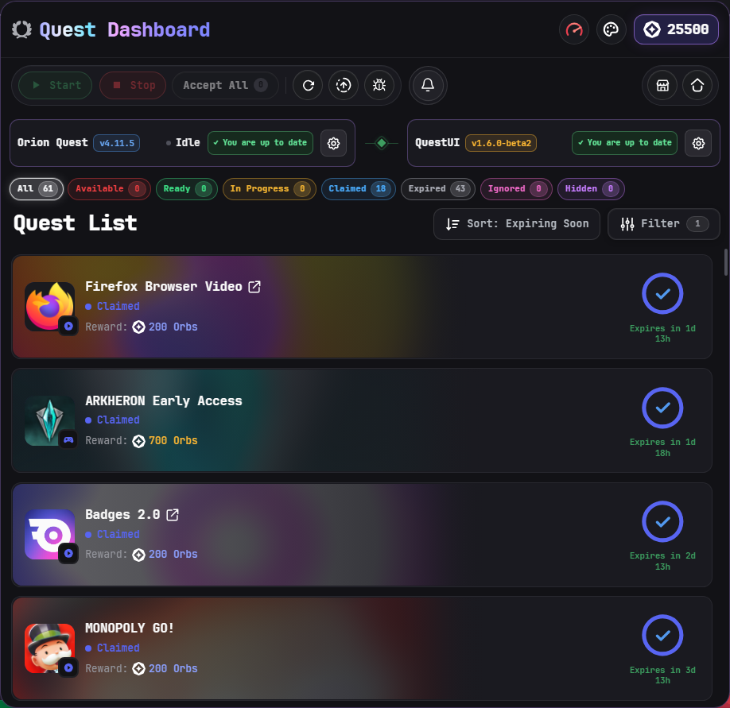
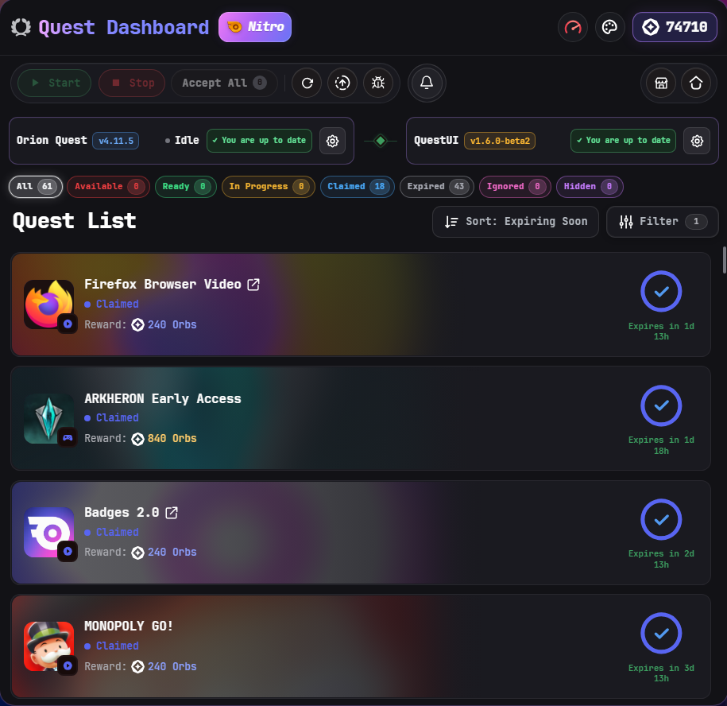
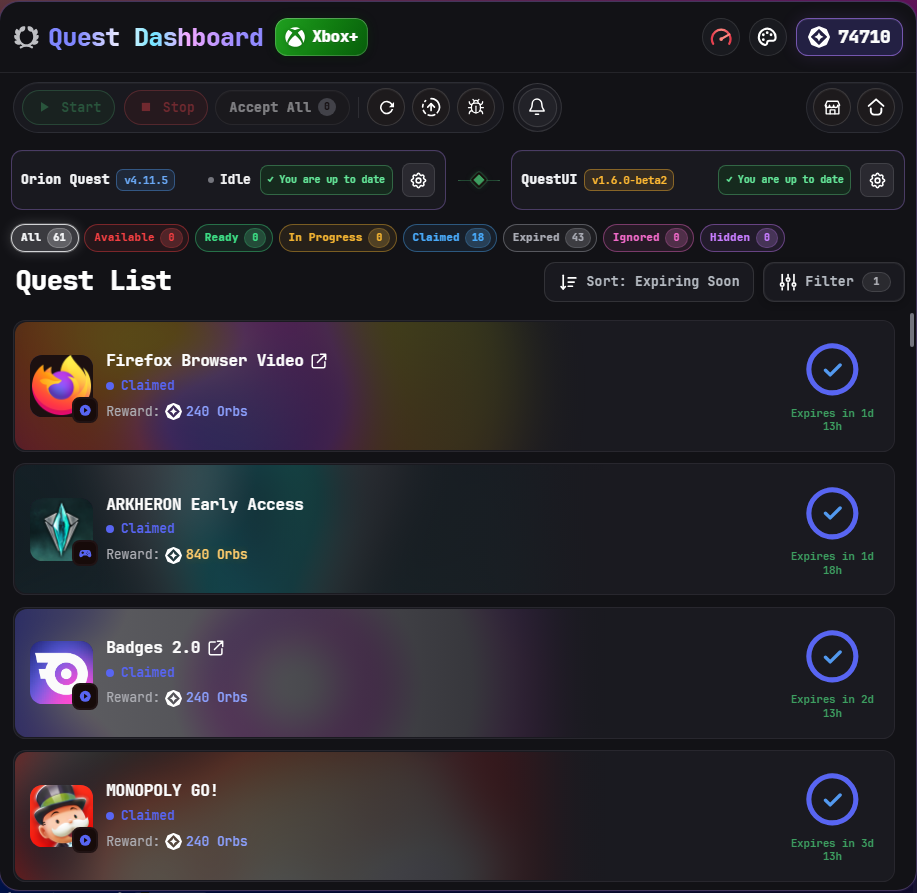
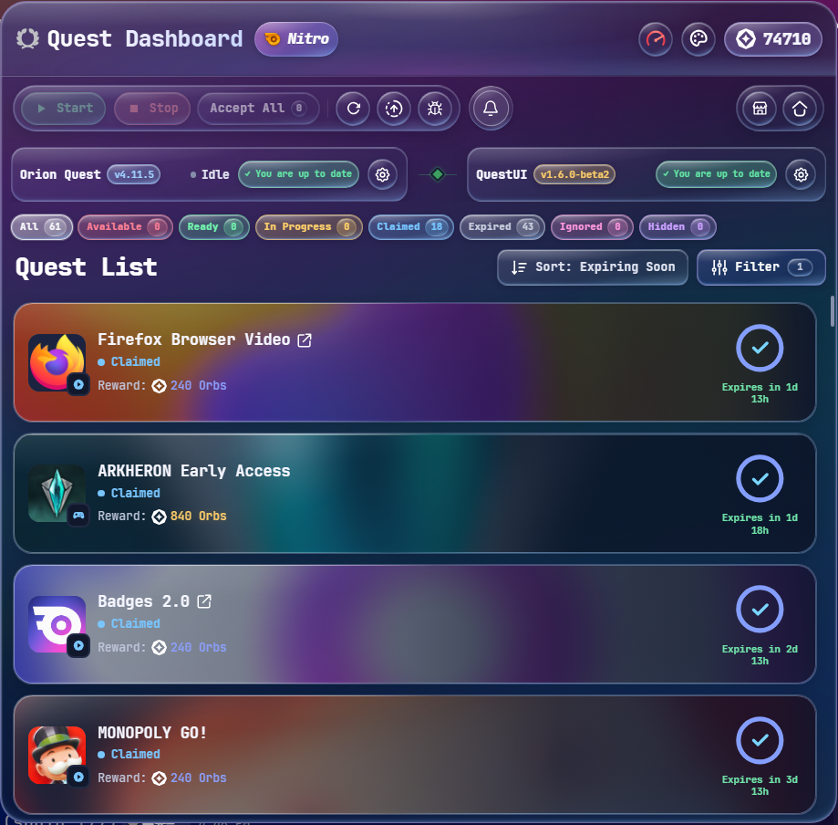
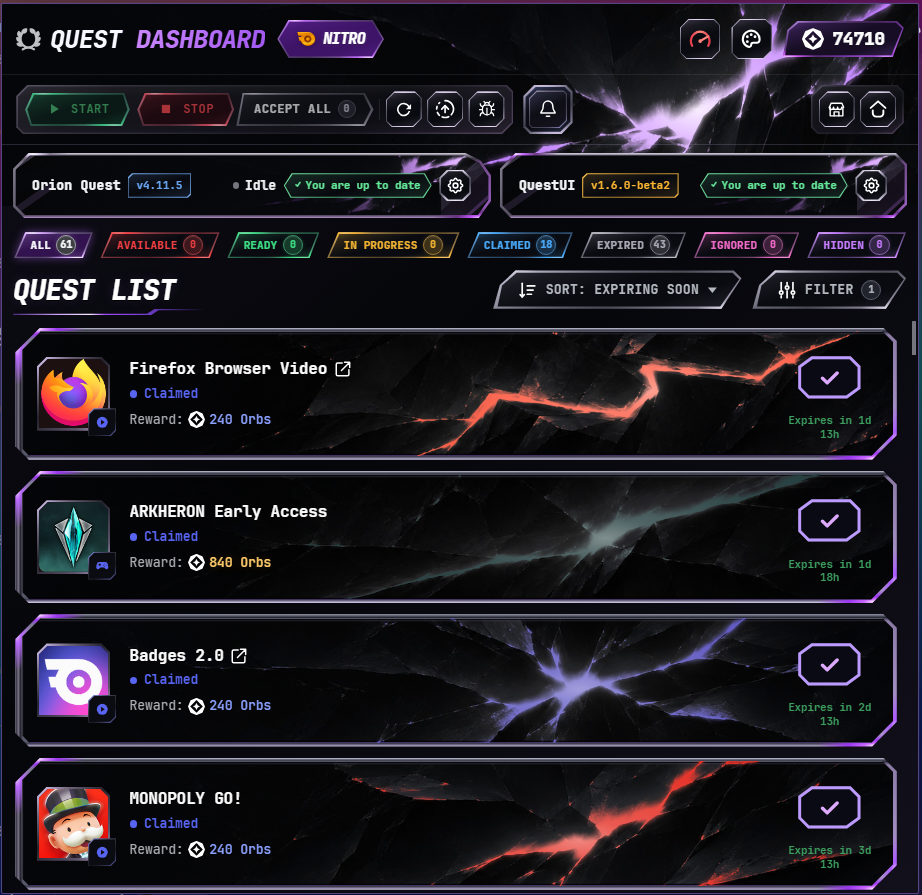
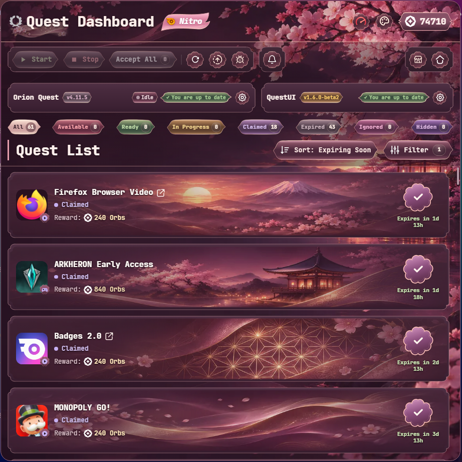
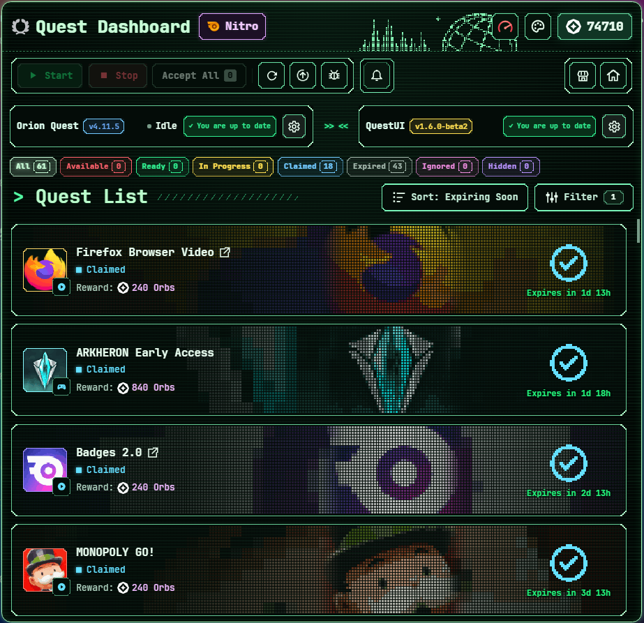
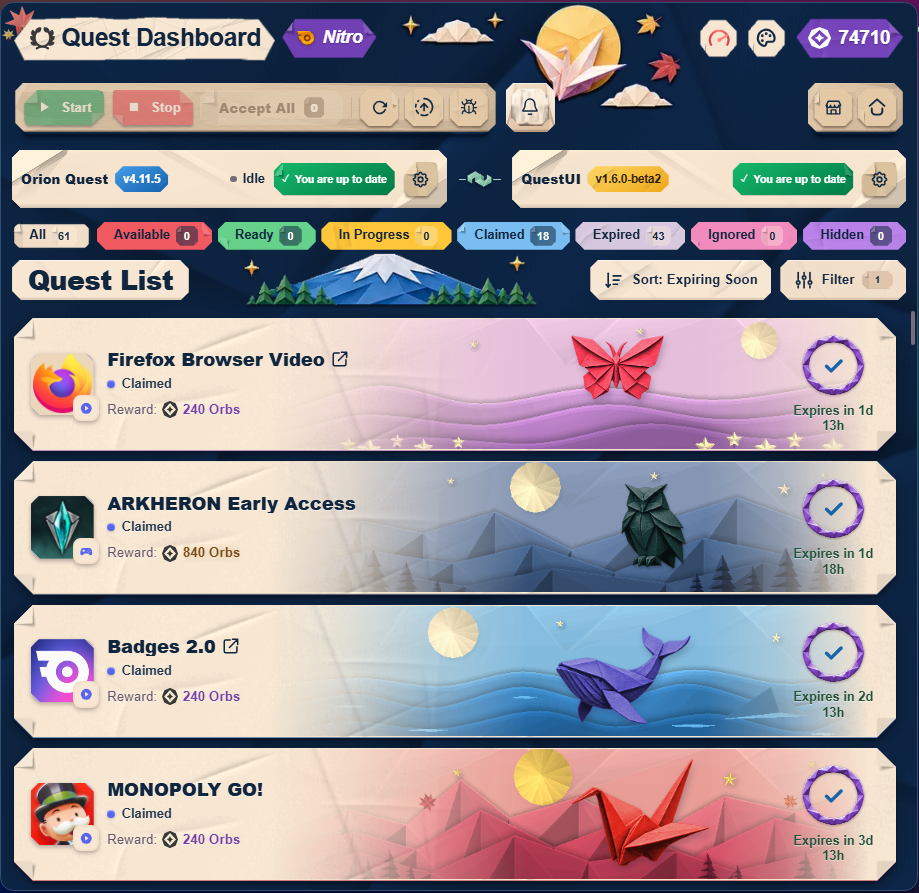
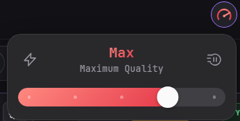

<div align="center">

# QuestUI

A live, compact Quest Dashboard inside Discord.

[](https://github.com/Herzchens/QuestUI/releases)
[](https://github.com/Herzchens/QuestUI/stargazers)
[](https://vencord.dev/)
[](https://betterdiscord.app/)
[](LICENSE)

<!-- Release badge color by stage: alpha = ED4245 (red), beta = FEE75C (yellow), stable = 3B82F6 (blue). Change color= in the Release badge when the stage changes. -->

[Integrate](#-integrate-with-questui) · [Features](#-features) · [Themes](#-themes) · [Orion](#-orion-integration) · [Install](#-installation) · [Troubleshooting](#-troubleshooting) · [FAQ](#-faq) · [Issues](https://github.com/Herzchens/QuestUI/issues)

</div>

QuestUI is a standalone Vencord userplugin that shows your Discord Quests in one dashboard: live progress, Orb rewards, expiry timers, notifications and diagnostics. The goal is simple: you should never need to open Discord's Quest Home.

QuestUI is a UI and diagnostics layer, not a Quest-completion engine. It reflects Discord's real state. Accepting Quests and claiming rewards only happens when you explicitly authorize it. Beyond that it only does housekeeping: refreshing the Quest list, checking for updates, sending notifications and, with Orion, enforcing Ignore.

| ✅ QuestUI does | ❌ QuestUI does not |
| --- | --- |
| Display live Quest state, rewards, progress and expiry timers | Generate Quest progress |
| Run Discord's native actions when you click them: Accept, Accept All, Claim, Claim All, Reload, View Code, Quick Open | Spoof games or streams |
| Show a status indicator for new 🔴, in-progress 🟡 and ready-to-claim 🟢 Quests | Farm in the background |
| Notify you and log diagnostics | Accept or claim without your authorization |
| Update itself and OrionQuests through a guarded Update Center | Bypass Discord challenges or CAPTCHAs |

Pair it with [OrionQuests](#-orion-integration) and QuestUI becomes the only window you need: open it, accept Quests, claim rewards. Control stays in your hands.

> [!NOTE]
> Client mods like Vencord are against Discord's Terms of Service. In practice Discord has been pretty indifferent, and there are no known cases of users getting banned for using them, but you use them at your own risk. QuestUI itself does not generate Quest progress, spoof activities or bypass verification challenges.

## 🔗 Integrate with QuestUI

> [!IMPORTANT]
> Want to use QuestUI as the UI layer for your own plugin? Open an issue to discuss integration surfaces.

<p align="center">
  <a href="https://github.com/Herzchens/QuestUI/issues/new"></a>
</p>

For an existing example of a companion integration, see [Orion Integration](#-orion-integration).

## ✨ Features

Status colors used across QuestUI: 🟡 In Progress · 🟢 Ready to Claim · 🔴 Available

### 🖥️ Dashboard Mode and Legacy Mode

- **Dashboard Mode (default):** floating Quest Dashboard with live cards, toolbar controls and status summaries. It also shows your live Discord Orb balance and has a shortcut to Discord's Shop / Market.
- Achievement Quests show segmented progress, and QuestUI shows its runtime version and integration health.
- **Legacy Mode:** turn Dashboard Mode off in plugin settings to keep only Discord's native Quest Home shortcut and status indicators.

### 💎 Orb rewards and multiplier

QuestUI shows the base and boosted reward quantities that Discord provides (`orbQuantity` and `premiumOrbQuantity`). It does not multiply or grant Orbs itself. It prefers Discord's native multiplier classifier and falls back to its own handling when the classifier is unavailable.

The **Nitro** or **Xbox+** badge in the header shows your subscription identity (Nitro wins when both apply). That does not necessarily mean your account is eligible for boosted Orb rewards, so go by the amounts on the cards.

<table align="center">
  <tr>
    <td align="center"><br><sub><b>Standard</b></sub></td>
    <td align="center"><br><sub><b>Nitro (1.2x)</b></sub></td>
    <td align="center"><br><sub><b>Xbox Game Pass (1.2x)</b></sub></td>
  </tr>
</table>

### 🗂️ Categories, filters and sorting

- **Quick categories:** `All`, `Available`, `Ready`, `In Progress`, `Claimed`, `Expired`, `Ignored`, `Hidden`. Each is an always-visible counter and an instant view.
- **Filters (multi-select):** status, Quest type (Play, Stream, Video, Activity, Other), reward category (Orbs, Collectibles, In-Game Rewards, Custom), Expired History window (7d, 15d, 30d, 90d, All) and the separate Ignored catalogue.
- **Sorting:** Expiring Soon, Highest Orb Reward, Shortest or Longest Required Time, Name A-Z or Z-A.

### 🎁 Accept, Claim and batch actions

**Accept Quest** and **Claim Reward** are explicit per-card native actions. The toolbar also has a dynamic batch button:

- At least one Quest is Ready to Claim: it shows **Claim All**.
- No Quest is Ready: it switches to **Accept All**.
- No eligible Quest remains: it stays **Accept All**, disabled.

Both batch actions pick their Quests from your active filters when the batch starts, and skip Ignored Quests. If you filter to Orbs, only Orb Quests are accepted or claimed.

Safeguards:
- Native requests are paced and run one at a time.
- Quest eligibility and account identity are rechecked before each action.
- Results are confirmed through Discord's QuestStore instead of assuming a request succeeded.
- Rate limits (HTTP 429, `Retry-After`) are detected and respected.
- The batch stops on account change, state mismatch, or a CAPTCHA/verification prompt. Results already confirmed are kept.
- **Claim All does not solve CAPTCHAs for you.**

### 🙈 Ignore Quest

- Account-scoped **Ignore / Unignore** for Available (unaccepted) and In Progress Quests.
- **Ignore rules:** in QuestUI plugin settings, add, edit or delete literal case-insensitive Quest-name matches or exact application IDs. Any matching rule excludes that Quest. Manual Unignore creates a per-Quest exception; manually ignoring it again clears the exception. Rules are local to the current account and never automatically start or resume a Quest.
- Ignored Quests leave the main list, attention dots, Detailed Status, Quest Home counters and QuestUI notifications. They stay in the Ignored catalogue until they are claimed or expire, then the entry is pruned.
- Ignored Quests are skipped by QuestUI's batch actions and Resume. Unignore a Quest before you accept or resume it. Unignore never starts or resumes a Quest by itself.
- Persistence is fail-closed: a failed storage read or write never drops existing exclusions.
- **With OrionQuests:** QuestUI watches for ignored Quests that become active in Orion and attempts to pause them through the companion controls. This is a reactive fallback, so an ignored Quest can run briefly before QuestUI catches it, and the attempt can fail if the controls are unavailable. Native exclusion on the Orion side is not available yet.

### 🚀 Quick Open, View Code and Reload

- **Quick Open:** launch enrolled, in-progress desktop video modals (`WATCH_VIDEO`) or Discord Activity hooks (`PLAY_ACTIVITY`, `ACHIEVEMENT_IN_ACTIVITY`) straight from the card, no external links.
- **View Code:** native reward-code access on supported claimed Quest cards.
- **Manual Reload:** triggers Discord's native current-Quest fetch (`QUESTS_FETCH_CURRENT_QUESTS_BEGIN`) without reloading the client.
- **Automatic Reload:** on by default every 5h (configurable from 10m to 24h). It runs silently even while the Dashboard is closed and shares one freshness timestamp with Manual Reload.

### 🚦 Status Indicator

- An optional Quest shortcut in Discord's top bar and/or bottom control bar.
- **Detailed Status attention priority:** 🟡 In Progress, 🟢 Ready to Claim, 🔴 Available (ignored Quests excluded), plus color-coded counters in Quest Home.
- **Update Indicator:** a dot colored by update severity when a QuestUI or OrionQuests update is available.

### 🔔 Notifications and Notification Center

- **Notification Center:** account-scoped inbox backed by sanitized Event Log events, with Quest artwork for supported events and per-account unread, read and clear state. Clearing the inbox never deletes Event Log history.
- **Notifications:** three independent toggles (New Quest Available, Ready to Claim, Problems), delivered through Vencord's Notifications API. Depending on your Vencord notification settings they appear as in-app toasts or native desktop notifications.

### 🧾 Event Viewer

- Shows QuestUI and Orion events only, with no Discord console spam.
- Search, Source / Level / Category filters, account-aware filtering, sorting, cursor pagination (250 events per page) and windowed rendering.
- Copy diagnostic reports, open the log folder or clear the Event Log from the viewer.
- Tokens and credentials are redacted before events are persisted locally to `QuestUI/events.jsonl`. The log is compacted from 10 MiB back toward 5 MiB.

> [!IMPORTANT]
> Redaction cannot guarantee coverage of every edge case. Review copied reports before sharing them publicly, and report any pattern that slipped through.

### 🛠️ Update Center

Supports QuestUI and OrionQuests, with per-product release-check health and last-success timestamps.

- **Update channels:** QuestUI and OrionQuests each have their own pre-release setting. You can opt in to pre-releases for one and turn off pre-release checks for the other.
- **Skip / Snooze:** Skip ignores that version. Snooze postpones it for 1 day.
- **QuestUI self-update:** requires a clean official-history checkout and a pinned-key SSH-signed annotated release target on official `main`. Dirty local work is never discarded.
- **OrionQuests update:** validates upstream `main` provenance and asks you to **Keep** or **Discard & update** on dirty or divergent checkouts. It snapshots the known-good Vencord runtime before rebuilding and rolls back if the build fails, as long as the checkout is still safe to restore. If your local state changed during the update, it refuses to roll back rather than overwrite newer work.

## 🎨 Themes

Six built-in themes, switchable from the palette button in the Dashboard. Each has its own visual identity and artwork, not just a recolor of Default. Your choice persists.

<table align="center">
  <tr>
    <td align="center"><br><sub><b>Default</b><br>Clean, Discord-style layout</sub></td>
    <td align="center"><br><sub><b>Liquid Glass</b><br>Translucent, layered surfaces</sub></td>
    <td align="center"><br><sub><b>Obsidian</b><br>Volcanic glass with glowing veins</sub></td>
  </tr>
  <tr>
    <td align="center"><br><sub><b>Sakura</b><br>Lacquer, silk and twilight scenery</sub></td>
    <td align="center"><br><sub><b>Terminal</b><br>Retro computing, pixel-art look</sub></td>
    <td align="center"><br><sub><b>Origami</b><br>Folded paper and creases</sub></td>
  </tr>
</table>

### Graphics Selector

The Graphics Selector next to the palette button sets one graphics quality for all themes. Each theme renders it in its own way.

| Level | What it means |
| --- | --- |
| `Light` | Low quality plus Reduced Motion |
| `Low` | Performance |
| `Medium` | Balanced |
| `High` | High quality |
| `Max` | Maximum quality (default) |
| `Ultra` | Coming soon |

Reduced Motion can be turned on independently of the quality level. QuestUI also follows your system's reduced-motion preference.

<p align="center">
  
</p>

## 🔌 Orion Integration

QuestUI detects [OrionQuests](https://github.com/nyxxbit/discord-quest-completer) automatically when a compatible build is installed next to it. No pairing step is needed. You can switch the integration off in QuestUI's plugin settings if you prefer standalone UI mode.

| Capability | Since QuestUI | OrionQuests |
| --- | --- | --- |
| Global Start / Pause / Resume / Stop, per-Quest Pause / Resume | v1.1.0 | v4.10.7+ |
| Persistent Event Log with Orion console lines | v1.2.0 | Console-based |
| Structured events and scheduler metadata | v1.3.0 | v4.11.0+ |
| Per-Quest state tags | v1.4.0 | v4.10.7+, full scheduler tags need v4.11.0+ |

Older compatible Orion builds still get state tags based on control state. With v4.11.0+ the tags show the real scheduler `STARTED` / `WAITING` state and live task progress. QuestUI does not keep a duplicate engine state.

> [!WARNING]
> The OrionQuests Bundle (standalone or prebuilt) is not supported. Use a Vencord source checkout or Orion's devbuild installer.

## 📦 Installation

### Requirements

- A Vencord source build. Userplugins cannot be loaded by prebuilt installers, browser extensions or the OrionQuests Bundle. See Vencord's official [custom plugins guide](https://docs.vencord.dev/installing/custom-plugins/).
- [Git](https://git-scm.com/), [Node.js](https://nodejs.org/) (current LTS) and [pnpm](https://pnpm.io/), the same toolchain Vencord needs to build from source.
- Discord desktop with Vencord injected. Quick Open targets desktop video modals and Activity hooks.

Platforms: QuestUI is designed with Windows, macOS and Linux in mind, but it includes native modules and managed updates, so behavior can differ between systems and compatibility is not guaranteed on every one. If something fails on yours, open an issue with your OS and an Event Viewer report. Orion's devbuild installer path below is Windows only (PowerShell and `UPDATE.cmd`).

### QuestUI

With UserpluginInstaller, use the repository URL on the default `main` branch:

```text
https://github.com/Herzchens/QuestUI
```

Manually from Vencord source:

```bash
cd Vencord/src/userplugins
git clone --branch main https://github.com/Herzchens/QuestUI.git QuestUI
cd ../..
pnpm build
pnpm inject
```

### QuestUI + OrionQuests

They stay separate userplugins. Use upstream OrionQuests v4.10.7+ (v4.11.0+ for full scheduler metadata and structured logging).

Sibling install in a normal Vencord source checkout:

```bash
cd Vencord/src/userplugins
git clone https://github.com/Herzchens/QuestUI.git QuestUI
git clone https://github.com/nyxxbit/discord-quest-completer.git OrionQuests
cd ../..
pnpm build
pnpm test:ts
pnpm inject
```

With Orion's devbuild installer (Windows):

```powershell
git clone https://github.com/Herzchens/QuestUI.git "$env:LOCALAPPDATA\OrionVencord\src\userplugins\QuestUI"
```

Then run `UPDATE.cmd` from the devbuild installer folder you originally extracted. It rebuilds Vencord with QuestUI included.

### Updating

> [!TIP]
> Use the Update Center when you can. Open it from the Dashboard toolbar or QuestUI's plugin settings. It verifies signed releases and rebuilds Vencord for you. In most cases there is no need to delete and re-clone QuestUI for a new release.

Manual updates. The Update Center installs signed releases as a detached checkout, so after a managed update `src/userplugins/QuestUI` may be in detached HEAD state, where a plain `git pull --ff-only` fails. Run `git status` first and commit, stash or move any local changes.

If the checkout is on `main`:

```bash
git -C src/userplugins/QuestUI pull --ff-only
pnpm build
pnpm inject
```

If `git status` says `HEAD detached`:

```bash
git -C src/userplugins/QuestUI fetch origin
git -C src/userplugins/QuestUI switch main
git -C src/userplugins/QuestUI pull --ff-only
pnpm build
pnpm inject
```

> [!WARNING]
> A manual pull skips the Update Center's signature and provenance checks. If the Update Center rejects a release, do not pull around it. Open an issue instead.

Orion devbuild installer (Windows): run `UPDATE.cmd` if your installer updates sibling userplugins (look for `Updating other userplugins in this checkout...`). Otherwise update QuestUI as above, using the path below, then run `UPDATE.cmd`:

```powershell
git -C "$env:LOCALAPPDATA\OrionVencord\src\userplugins\QuestUI" pull --ff-only
```

If `src/userplugins/QuestUI` is not a Git checkout, move it aside instead of deleting it, then clone again.

## 🩺 Troubleshooting

| Symptom | Likely cause | Fix |
| --- | --- | --- |
| No Dashboard, only a Quest shortcut | Dashboard Mode is off, so QuestUI is in Legacy Mode | Enable Dashboard Mode in QuestUI's plugin settings |
| QuestUI missing after install | Not built or injected, or the plugin is disabled | Run `pnpm build` and `pnpm inject`, restart Discord, then enable QuestUI in Vencord plugins |
| Orion controls do not appear | Orion too old, Bundle build, or integration toggled off | Use upstream Orion v4.10.7+ from source (v4.11.0+ for full scheduler metadata and structured logging), and check the integration toggle |
| An ignored Quest briefly started in Orion | The Orion fallback is reactive | Expected. QuestUI attempts to pause it once it detects it. If it stays active, pause it from Orion and check that the companion controls are available |
| Quest list looks stale | Last refresh was a while ago | Use Reload, or lower the automatic reload interval (minimum 10m) |
| Animations are still reduced with Reduced Motion turned off | Your system's reduced-motion preference still applies, or Graphics is set to Light, which includes Reduced Motion | Pick a Graphics level above Light, then check your OS animation setting (see below) |
| Cannot accept or resume a Quest | The Quest is Ignored | Unignore it first |
| Claim All stopped midway | Account change, state mismatch, rate limit, or a CAPTCHA/verification prompt | Finish any verification in Discord, wait out the rate limit, then run it again. Results already confirmed are kept |
| Update Center refuses to update QuestUI | Dirty checkout, history that is not official, or an unsigned release target | Commit, stash or move local changes. Do not bypass a failed signature or provenance check with `git pull`. Open an issue |
| `git pull --ff-only` fails after an update | The checkout is in detached HEAD state | See [Updating](#updating) |
| No notifications | The category is toggled off, or Vencord notification settings block them | Check QuestUI's three notification toggles and Vencord's notification settings |

Where to find your OS animation setting (QuestUI follows it, so animations stay reduced while it asks for reduced motion):
- **Windows 11:** Settings > Accessibility > Visual effects > turn Animation effects on
- **Windows 10:** Settings > Ease of Access > Display > turn Show animations in Windows on
- **macOS:** System Settings > Accessibility > Display > turn Reduce motion off (on newer versions it is under Accessibility > Motion)
- **GNOME:** Settings > Accessibility > Seeing > turn Reduced animation off (older versions: GNOME Tweaks > General > Animations)
- **Other Linux desktops:** look for an animations or reduce-motion option in your desktop's accessibility or appearance settings

Reporting a bug? Open an [issue](https://github.com/Herzchens/QuestUI/issues) and attach a report from the Event Viewer. Review it for sensitive data first.

## ❓ FAQ

<details>
<summary><b>Does QuestUI complete Quests for me?</b></summary>
<br>
No. It shows Discord's real Quest state, never generates progress, and accepts Quests or claims rewards only with your explicit authorization.
</details>

<details>
<summary><b>Do I need OrionQuests?</b></summary>
<br>
No. QuestUI works standalone. OrionQuests only adds the companion controls listed in <a href="#-orion-integration">Orion Integration</a>.
</details>

<details>
<summary><b>Will Claim All claim everything?</b></summary>
<br>
Only Quests that are Ready to Claim and match your active filters when the batch starts. Ignored Quests are skipped, and it stops on CAPTCHA or verification prompts without solving them.
</details>

<details>
<summary><b>Does clearing the Notification Center delete my logs?</b></summary>
<br>
No. Clearing the inbox only affects that account's unread, read and clear state. Event Log history is kept in <code>QuestUI/events.jsonl</code>.
</details>

<details>
<summary><b>Can I create custom themes?</b></summary>
<br>
The v1.6.0 development branch includes a versioned Theme SDK for trusted local Vencord userplugins. See [Theme SDK](docs/THEME_SDK.md) for usage, lifecycle and limitations.
</details>

## 🙏 Credits

QuestUI is maintained by [Herzchens](https://github.com/Herzchens).

It began by extracting and refactoring the small Quest shortcut and status-dot surface from [nicola02nb/completeDiscordQuest](https://github.com/nicola02nb/completeDiscordQuest). The completion engine was not carried over. The rest of QuestUI's implementation was developed independently: the Dashboard, themes, graphics and motion controls, Quest cards, manual and batch actions, Event Log, notifications, Notification Center, updater and reward filtering. The Orion companion features build on OrionQuests' companion APIs, shaped through upstream collaboration with nyxxbit.

Thanks to:
- **nicola02nb** for the original shortcut icon and status-dot seed.
- **[nyxxbit](https://github.com/nyxxbit)** for upstream collaboration, companion API review, live integration testing and keeping OrionQuests compatible with QuestUI.
- **The Vencord contributors** for the plugin framework.

QuestUI is maintained independently and is not affiliated with or endorsed by `completeDiscordQuest`, OrionQuests, Discord or Vencord.

## 📄 License

See [LICENSE](LICENSE).
